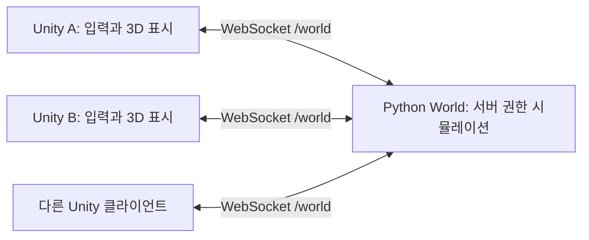

# 구조와 코드 설명

## 실행 흐름

Unity 클라이언트가 입력을 보내면 Python 서버가 이동 가능 범위와 속도를 검증합니다. 서버는 모든 플레이어의 위치를 계산해 전체 상태를 전송하고, 각 Unity 화면은 받은 좌표를 부드럽게 보간해 표시합니다.

서버는 Unity Editor나 Unity 실행 파일 없이 별도로 동작합니다. 초기 접속과 공용 필드의 통신을 작은 규모로 실험하기 위해 엔진 외부 서버와 WebSocket을 사용했습니다. Unity 패키지 기반 네트워킹 프레임워크에 의존하지 않으며, 서버와 클라이언트의 책임을 코드로 확인할 수 있습니다.

## 파일별 역할

| 파일 | 역할 |
| --- | --- |
| Assets/Scenes/SharedWorld.unity | KjsDemo가 연결된 실제 시작 씬 |
| Assets/Kjs/Runtime/KjsDemo.cs | 접속 UI, 입력 전송, 패킷 처리, 채팅 UI와 세션 수명 관리 |
| Assets/Kjs/Runtime/WorldClient.cs | 비동기 WebSocket 연결·전송·수신·취소와 제한된 수신 큐 |
| Assets/Kjs/Runtime/Protocol.cs | Unity JsonUtility용 직렬화 DTO |
| Assets/Kjs/Runtime/WorldView.cs | 필드·카메라·조명, 캐릭터 생성/삭제, 좌표 보간과 이름표 |
| Assets/Resources/KjsSurface.mat | 빌드에 포함되는 Built-in Standard 셰이더 재질 |
| Assets/Kjs/Editor/BuildCommands.cs | 씬 열기 메뉴와 현재 데스크톱 대상 빌드 |
| Server/server.py | 접속·입력 검증, 권한 있는 플레이어 상태, 고정 틱 루프, 채팅 |
| Server/tests/test_server.py | 실제 소켓 통합 시험과 이동 규칙 회귀 시험 |
| Tools/load_test.py | 여러 소켓 클라이언트의 동시 입력·채팅·상태 수신 시험 |
| Tools/TransportProfile | 실제 WorldClient/Protocol 코드를 .NET Standard 2.1로 컴파일하는 프로젝트 |
| Tools/TransportSmoke | 실제 C# 통신 코드 2개를 서버에 연결하는 실행 시험 |
| Assets/Kjs/Tests/PlayMode | Unity 씬 로딩 및 Unity 런타임 네트워크 시험 소스 |

## 서버의 주요 함수

`World.handle()`은 `/world` 접속에서 첫 패킷으로 버전 1의 join을 받습니다. 닉네임과 정원을 검증한 뒤 서버가 UUID를 발급합니다. 정원 확인과 등록 사이에는 await가 없어 같은 이벤트 루프에서 동시 등록으로 정원을 넘지 않습니다. welcome을 송신 큐의 맨 앞에 넣고 개별 송신 작업을 시작하므로 첫 상태 패킷보다 welcome이 먼저 나갑니다.

`World.apply_packet()`은 input, chat, ping을 처리합니다. input에는 방향과 증가하는 seq만 사용합니다. 클라이언트가 x, z, speed, dt를 보내더라도 위치 계산에는 사용하지 않습니다. NaN·무한대, 잘못된 자료형, 1을 넘는 방향 값은 거절하고 대각선 벡터는 길이 1로 정규화합니다. 이미 처리한 seq 이하의 입력은 무시합니다.

`World.step()`은 서버 시간으로 이동을 계산합니다. 기본 속도는 초당 5 유닛, 틱은 20 Hz, X/Z 경계는 각각 -24부터 24입니다. 0.30초 동안 새 입력이 없으면 멈춥니다. 시간 간격을 한 틱 이하로 제한하므로 서버 지연이 큰 순간에도 갑작스러운 대량 이동을 허용하지 않습니다. 지연을 보상하는 예측 모델은 구현하지 않았습니다.

`World.tick_loop()`는 step 이후 snapshot을 전송합니다. 현재 구조는 전체 플레이어 상태를 모든 사용자에게 보내므로 총 전송량은 플레이어 수의 제곱에 비례해 증가합니다. 설정 가능한 정원 1~256은 입력 범위이며, 실제 동작을 시험한 수는 64입니다.

`World._sender()`는 연결별 송신을 하나로 직렬화합니다. 송신 큐가 8개를 넘거나 전송이 지연되면 해당 사용자를 종료해 다른 사용자들의 틱을 막지 않도록 합니다. 접속 종료 경로의 finally에서 플레이어를 제거하고 left를 전달합니다.

## 클라이언트의 주요 함수

`WorldClient.ConnectAsync()`는 제한 시간 안에 접속하고 join을 먼저 전송합니다. `ReceiveLoopAsync()`는 분할된 WebSocket 프레임을 하나의 메시지로 조립합니다. 메시지 최대 크기는 256 KiB이며 수신 큐는 64개입니다. `SendAsync()`는 SemaphoreSlim으로 동시에 두 전송이 수행되지 않게 하고 전송 제한 시간을 둡니다.

네트워크 작업은 Unity API를 호출하지 않습니다. 수신 문자열은 ConcurrentQueue에 쌓고 `KjsDemo.Update()`가 메인 스레드에서 `JsonUtility.FromJson`으로 처리합니다. Unity 오브젝트 생성·삭제와 UI 변경도 메인 스레드에서 이루어집니다.

`KjsDemo.Update()`는 초당 최대 10회 input을 보냅니다. 텍스트 입력 또는 창 비활성화 중에는 방향 0을 보냅니다. 서버가 ID를 부여하기 전에는 게임 입력을 보내지 않으며, 5초간 snapshot이 없으면 접속을 정리합니다. 재접속은 새 WorldClient와 새 서버 ID로 시작합니다. GUI 포커스 해제는 OnGUI 안에서 수행합니다.

`WorldView.Apply()`는 snapshot의 ID를 기준으로 캐릭터를 생성하고 사라진 캐릭터를 제거합니다. `LateUpdate()`는 서버 좌표와 회전을 보간합니다. 로컬 플레이어도 서버가 전송한 위치를 사용하며, 클라이언트 예측과 재조정은 없습니다. 이동 지연이 보일 수 있지만 서버 권한 처리 과정을 관찰하기 쉽습니다.

## 초기 프로젝트의 경계

현재 서버는 메모리에만 상태를 보유합니다. 닉네임은 로그인 계정이 아니며 중복을 허용합니다. 계정 인증, 캐릭터 영속 저장, 전투·퀘스트·인벤토리, 충돌, 관심 영역 관리, 여러 지역과 서버 분할은 구현하지 않았습니다. WebSocket은 TCP 순서 전달을 사용하므로 네트워크 손실 시 지연 특성을 별도로 평가해야 합니다.

다음 단계에서는 목표 동시 접속 수와 플레이 규칙을 먼저 정하고 인증·저장·지역 분리·배포 방식을 설계하는 것이 필요합니다. 이 항목들은 후속 제안이며 이미 구현되었거나 승인된 일정으로 취급하지 않습니다.
